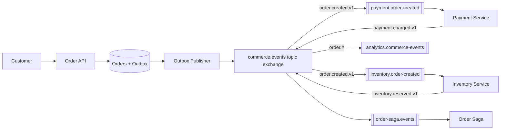

# Architecture 01 - E-commerce Order Processing

## Requirement

After checkout, charge payment, reserve stock, create shipment, send notifications, and update analytics without making the HTTP request wait for every operation.

## Suggested Flow

## Topology

| Item | Example |
|---|---|
| Exchange | `commerce.events`, durable topic |
| Payment queue | `payment.order-created`, quorum |
| Inventory queue | `inventory.order-created`, quorum |
| Saga queue | `order-saga.events`, quorum |
| Routing keys | `order.created.v1`, `payment.charged.v1` |
| DLQs | one owned DLQ per consumer service |

## Reliability

- Order and outbox rows are inserted in one database transaction.
- Outbox publisher uses persistent messages and publisher confirms.
- Consumers acknowledge only after their local database transaction commits.
- Each consumer stores the message ID with its database update.
- Retries are bounded; invalid orders go to the service's DLQ.
- The saga stores workflow state in a database, not only in messages.

## Failure Examples

**Payment provider times out:** retry with exponential backoff using the provider's idempotency key.

**Stock unavailable:** publish `inventory.rejected.v1`; this is a business outcome, not a technical retry.

**Payment succeeds but acknowledgement is lost:** payment message is redelivered. The unique operation key returns the existing charge instead of charging again.

**Payment succeeds but stock fails:** saga requests a compensating refund and marks the order cancelled when compensation completes.

## Important Trade-off

Do not broadcast `charge-card` as an event. It is a command with one logical owner. Broadcast facts such as `payment.charged` after the owner completes it.

