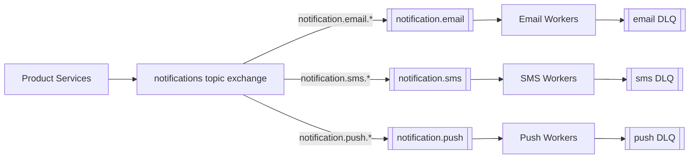

# Architecture 02 - Notification Platform

## Requirement

Product services send email, SMS, and push notifications. Providers have different speed, failure behavior, and rate limits.

## Suggested Flow



Example routing keys:

```text
notification.email.transactional
notification.email.marketing
notification.sms.otp
notification.push.activity
```

## Why Separate Queues?

- A slow SMS provider does not delay email.
- Each channel scales independently.
- Each queue has its own retry, TTL, rate, and alert policy.
- Workers use channel-specific provider credentials and payload validation.

## Production Details

- Store templates centrally and send a template ID plus variables.
- Store user consent and preference checks in a reliable service/database.
- Apply provider and tenant rate limits before making external calls.
- Use idempotency key `notification_id + channel`.
- Record provider response IDs for support and reconciliation.
- Never place provider credentials in messages.
- Keep marketing and transactional workloads separate if their priorities and legal requirements differ.

## Failure Policy

| Failure | Handling |
|---|---|
| Provider 429 | Delayed retry honoring `Retry-After` |
| Provider 5xx/timeout | Bounded exponential retry |
| Invalid phone/email | Permanent failure; no technical retry |
| Template missing | DLQ and alert |
| User opted out | Record skipped business result |

## Capacity Concern

Adding consumers can violate a provider's rate limit. Consumer count is not the only scaling control; use distributed rate limiting and back pressure.

