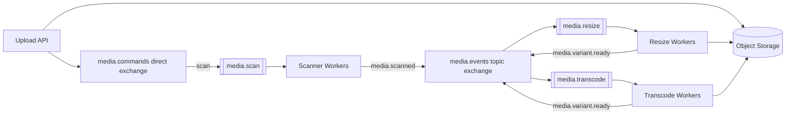

# Architecture 03 - Media Processing Pipeline

## Requirement

Users upload images or videos. The system scans, resizes, transcodes, extracts metadata, and notifies the user.

## Suggested Flow



## Message Shape

Send a reference, not the binary file:

```json
{
  "message_id": "uuid",
  "asset_id": "asset-123",
  "object_key": "uploads/asset-123/original.mp4",
  "operation": "transcode",
  "profile": "720p"
}
```

## Why RabbitMQ Fits

- Work is asynchronous and expensive.
- Competing workers distribute tasks.
- Queues absorb upload bursts.
- Scan, image, and video workers scale independently.

## Reliability and Scaling

- Use low prefetch for expensive video jobs.
- Acknowledge after output is durably stored and metadata committed.
- Use deterministic output keys so duplicate work overwrites or reuses the same result safely.
- Limit queue length or admission rate to protect storage and workers.
- Track message age because a queue of 100 video jobs may be more serious than a queue of 10,000 thumbnails.
- Use separate queues for tasks with very different CPU, memory, or GPU needs.

## Failure Examples

- Corrupt input: permanent failure and DLQ.
- Worker process crash: unacked work is redelivered.
- Object storage timeout: delayed bounded retry.
- Unsupported codec: record a user-visible failed status, not endless retry.

