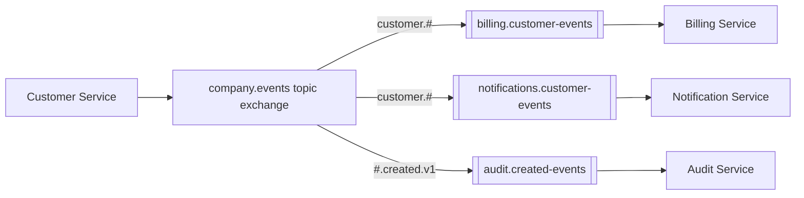

# Architecture 04 - Microservice Events and Workflows

## Requirement

Services publish domain events that other services consume independently, without the publisher knowing all subscribers.

## Suggested Flow



## Key Rule

Each independent service gets its own queue. If Billing and Notifications share one queue, each message goes to only one of them, which is incorrect for events both must observe.

## Event Contract

```json
{
  "message_id": "uuid",
  "event_type": "customer.created",
  "schema_version": 1,
  "occurred_at": "2026-06-07T10:30:00Z",
  "producer": "customer-service",
  "correlation_id": "trace-123",
  "data": {
    "customer_id": "CUS-7"
  }
}
```

Publish stable identifiers. A consumer can query the owning service when it needs current data, or the event can carry an intentional snapshot. Avoid leaking the producer's internal database model.

## Evolution

1. Add optional fields.
2. Deploy consumers that accept old and new forms.
3. Start publishing the new form.
4. Remove old fields only after all consumers migrate, usually in a new version.

## Failure Isolation

- Each consumer service owns retries and a DLQ.
- A broken analytics consumer does not block billing.
- Slow consumers build backlog only in their queue.
- Publishers are not redeployed when a new subscriber binds a new queue.

## Risk: Event Choreography Sprawl

Many event reactions can hide the end-to-end workflow. Use correlation IDs, central tracing, an event catalog, clear ownership, and possibly a saga orchestrator when the process needs explicit state and compensation.

