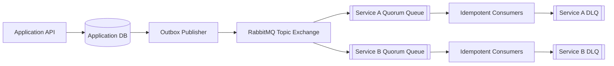

# RabbitMQ Architecture Guide

Architecture is not "put a queue between every service." Start from the business interaction, delivery requirement, failure behavior, and ownership.

## Basic Building Blocks

```text
Command:
API -> command exchange -> one service queue -> competing workers

Event:
Service -> topic exchange -> service A queue
                          -> service B queue
                          -> audit queue
```

Use one queue per independent event-consuming service. Multiple instances of the same service normally consume from that service's queue.

## Case Studies

| Example | Main lesson |
|---|---|
| [E-commerce Orders](./01-ecommerce-orders.md) | Reliable commands, outbox, idempotency, and saga |
| [Notification Platform](./02-notification-system.md) | Topic routing, provider isolation, retries, and rate limits |
| [Media Processing](./03-media-processing.md) | Work queues, back pressure, large payload references |
| [Microservice Events](./04-microservices-events.md) | Domain events, per-service queues, schema evolution |

## Design Method

For every message flow, decide:

1. **Meaning:** command, event, reply, or scheduled work?
2. **Owner:** who publishes and who owns consumption?
3. **Topology:** exchange type, routing key, queue type, bindings?
4. **Guarantee:** may it be lost, delayed, duplicated, or reordered?
5. **Failure:** retryable failure or permanent failure?
6. **Safety:** how is duplicate processing made harmless?
7. **Capacity:** expected rate, payload size, processing time, burst size?
8. **Operations:** dashboard, alert, DLQ owner, replay procedure?

## Recommended Production Shape



This is a starting point, not a universal template. Noncritical or temporary work may not need quorum queues or an outbox.

